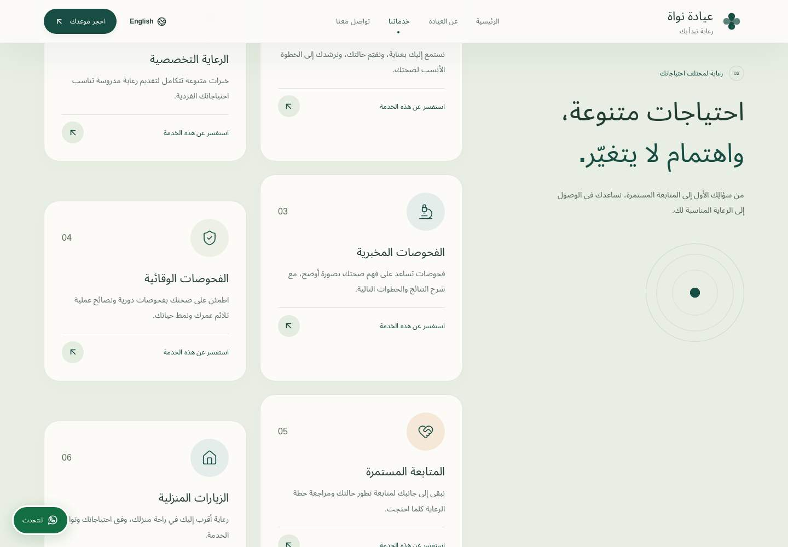

# Nawa orbital UI redesign

## Inspection

React 19, strict TypeScript, Vite 8, Tailwind v4, and Lucide. Section components live in `src/components`; business data and bilingual dictionaries live in `src/data` and `src/i18n`. Arabic is the default (`lang="ar"`, `dir="rtl"`), with a persistent English switcher. Existing Cairo / Plus Jakarta Sans fonts use `display=swap`. Artwork is original inline SVG/CSS. Vite configuration and build scripts are unchanged. A follow-up `wrangler.jsonc` now declares the static assets and SPA fallback routing for Cloudflare Workers.

## Changes

- Header: retained keyboard navigation and language switcher; smaller brand and header on scroll with a translucent blurred surface.
- Hero: enlarged Arabic hierarchy, warm cream/sage mesh, layered orbital decoration, retained clinic illustration, and independently moving reassurance badges. Existing statistics count up once while assistive technology receives the final value throughout.
- About: sand-colored arched illustration, orbital parallax, softer value cards, and staggered fade/translate/scale reveals.
- Services: native CSS sticky introduction beside six sequential cards on desktop; rounded sage chapter, circular icons, staggered layout, and hover glow/lift. Mobile uses a normal flowing layout.
- Contact, location, footer: warm contact surface, softer form and map panels, rounded footer transition. Validation, WhatsApp handoff, phone/email links, lazy map, and all business text remain unchanged.
- CTAs: animated sheen and lift, with existing focus treatments and mirrored directional icons.

`src/scene.css` extends the original theme with surface, spacing, radius, shadow, and easing tokens. `useSceneMotion` batches scroll/pointer updates into a single requested animation frame, reads geometry on setup/resize rather than per scroll, and limits mobile intensity. `useScrollReveal` remains the IntersectionObserver reveal utility. Motion updates use transforms/opacity; reduced-motion disables parallax, counter animation, sticky storytelling, and heavy effects. No new dependencies.

## Validation

- `npm run build`, `npm run lint`, and `git diff --check`: pass.
- `npm run test:browser`: pass. Both Arabic and English tested at 320, 360, 375, 390, 768, 1024, 1440, and 1920px; no horizontal overflow. Covers menu keyboard behavior, language persistence/blocked storage, localized form validation, Arabic phone digits, encoded WhatsApp handoff, external-link safety, contrast, map configuration, live reduced-motion changes, sticky services, and scroll parallax.
- Additional pointer-motion and mobile viewport inspection: pass.
- Local production-preview mobile Lighthouse: performance **99**, accessibility **100**, best practices **96**, SEO **91**; FCP 1.4s, LCP 1.7s, CLS 0 in the first run. Lab measurements vary.

The audit browser reports `ERR_CERT_AUTHORITY_INVALID` for Google Fonts in this managed environment, so screenshots and scores use fallback fonts. The live Workers URL likewise could not be visually inspected in Chromium; its HTML was retrieved successfully using the environment's trusted HTTP client. The external Google Maps document was blank in automation; iframe space, lazy loading, accessible title, and directions URL were verified. No production deployment or real WhatsApp message was performed.

## Screenshots

## Cloudflare preview build fix

The Cloudflare log confirmed that `npm run build` succeeded, then `npx wrangler preview` failed because the repository had no `previews` configuration. Added `wrangler.jsonc` with `name: clinic-project`, `assets.directory: ./dist`, SPA fallback, a compatibility date, and an empty `previews` block, following the [Cloudflare preview configuration documentation](https://developers.cloudflare.com/workers/previews/configuration/). No CLI or runtime dependency was added. The existing Cloudflare build/deploy commands can remain unchanged.

Validation: `npm run build`, `npm run lint`, and Wrangler 4.161.0 `deploy --dry-run` pass; Wrangler finds the built static assets without configuration errors.
